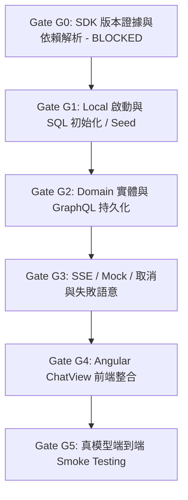

# MVP 實作計畫 (MVP Implementation Plan)

> 狀態：待驗收草案，2026-11-10。  
> 當前門禁現況：**Gate G0 目前狀態為 BLOCKED**（因本機缺少 JDK 27 toolchain 下載解析器且未配置 resolver，且前端套件鎖版尚未完成）。  
> 角色分工：**Codex / root** 負責思考、分析、決策與驗收；**agy**（執行者）負責開發、文件、耗 token 操作；**Luna** 負責套件與相容性研究（維護官方資料表，本檔不修改其研究文件）。  
> 最新覆蓋決策：**MVP 徹底不使用 Spring Security / OAuth2、Liquibase、MCP 與 Spring Modulith**。取消任何恢復此四項依賴或 G5 Modulith 評估門禁之規劃；採用應用層 Local Loopback 檢查、編號 SQL 初始化腳本加執行記錄表，以 Spring Data JDBC 完成純淨閉環。  
> 關聯文件：[DEVELOPMENT_PLAN.md](../DEVELOPMENT_PLAN.md)、規格說明書 [docs/specs/local-chat-mvp.md](specs/local-chat-mvp.md)、環境基線客觀證據 [docs/research/environment-baseline.md](research/environment-baseline.md)、套件研析 `docs/research/mvp-dependencies.md`。

---

## 1. 執行綱要與決策邊界

本計畫將首版 MVP 聚焦於「最小可用聊天閉環」，並建立嚴謹的工程門禁（Gates G0 ~ G5）。

### 1.1 核心決策與範圍邊界
1. **Local-only 安全與身分語意**：
   - `local` profile 限制於 loopback（127.0.0.1 / 本機存取），身分由伺服器固定解析為 `dev-user`，**嚴禁讓 client 端自訂或傳入 userId**。
   - **Fail-fast 啟動檢查**：非 local profile 的環境直接在啟動時拒絕啟動（Fail-fast abort），**完全不引入 Spring Security 或 `SecurityFilterChain`**。
2. **Seed Bot**：
   - 經由編號 SQL 種子腳本植入預設 Bot（例如 `bot-general`，名稱「General Assistant」），MVP 暫不實作多 Bot 建立/編輯/切換介面。`systemPrompt` 屬於內部設定，不暴露於外部 GraphQL UI 查詢。
3. **編號 SQL 初始化與 PostgreSQL 短交易持久化**：
   - 建立編號 SQL 遷移腳本（例如 `V1__init_schema.sql`、`V2__seed_bot.sql`）搭配 `schema_version` 記錄表管理執行歷史，支援乾淨 PostgreSQL 初始化與重複啟動冪等測試，**完全不依賴 Liquibase**。
   - 使用 Spring Data JDBC，嚴格短交易寫入，**模型串流期間絕不持有資料庫連線或開著長交易**。
   - 核心實體：`bot`、`conversation`、`message`、`agent_run`。
4. **GraphQL API（結構化操作）**：
   - 負責查詢 Bot 清單、查詢對話清單、訊息歷史、Run 狀態查詢，以及建立新對話。
   - 所有列表查詢（bots, conversations, messages, runs）參數一致，預設 20 筆、上限 100 筆，穩定排序（`created_at DESC, id DESC`）。
5. **POST + SSE API（串流與執行契約）**：
   - 前端發起請求採用 HTTP POST，後續以單向 Server-Sent Events (SSE) 接收串流。
   - **去重與防重送響應分支**：
     - 首次發起請求：回傳 `HTTP 200` 搭配 `Content-Type: text/event-stream` 進行 SSE 串流。
     - 重複請求且內容相同（去重命中）：回傳 `HTTP 200` 搭配 `Content-Type: application/json` 返回既有 run 的 metadata（**絕不偽造或聲稱重播即時 SSE！**）。
     - 重複請求但內容衝突：回傳 `HTTP 409 Conflict`。
   - **單一對話單一活躍 run（DB 約束）**：`PENDING` 與 `RUNNING` 狀態均佔用活躍 run，資料庫透過 **Partial Unique Index** 嚴格保證同一對話最多僅能存在一個活躍 run（因關聯式資料庫 CHECK constraint 無法跨 row 檢查）。若有進行中 run 則拒絕新發起之請求。
   - 所有 SSE 事件均攜帶**遞增序號（`seq`）**與 `runId`。
   - **單一 Terminal 狀態與原子競爭**：run 生命週期終態（`COMPLETED`、`FAILED`、`CANCELLED`）只能透過 CAS/原子更新決定且**最多一次（at most once）**。已 `COMPLETED` 的 run 絕不能被底層 `onCompletion` 覆寫為 `CANCELLED`。
   - 斷線時客戶端無法接收 cancelled 事件，重新連線時必須能透過 GraphQL 查詢 run 最終狀態。
   - 取消支援：客戶端主動中斷或呼叫取消端點；取消操作具備冪等性。
   - 伺服器重啟恢復：伺服器重新啟動時，若資料庫中存在殘留 `PENDING` 或 `RUNNING` 的孤兒 run，啟動階段必須主動將其標記為 `FAILED`（理由：`SYSTEM_RESTART_ORPHAN`）。
   - 部分答案處理：中斷或失敗時的部分累積文字寫入 message 表時必須標記 `interrupted: true`，且**嚴禁默認注入作為後續回合的成功上下文**。
   - 後續聊天上下文組裝：僅檢索歷史中 `interrupted: false` 且關聯 run 為 `COMPLETED` 的成功訊息，並設定滑動窗口上限（如最近 10 則）。
6. **Angular CopilotKit ChatView（無 Copilot Runtime）**：
   - 前端採用 CopilotKit Angular 的 `CopilotChatView` 作為 UI 呈現元件。
   - **完全不依賴、不安裝 Copilot Runtime**。由 Angular 自建服務負責 `fetch()` POST SSE 與 GraphQL 轉譯。
7. **前端視覺雛形規格（依據 approved prototype）**：
   - 佈局與風格：白底配色，不引入額外重型 UI framework。
   - 左側窄 Sidebar（寬度約 240px）：頂部工作區標題框、下方 Bot 區與最近對話清單。
   - 頂部 Main Header：顯示當前對話標題與「新對話」按鈕。
   - 中央對話區：User 訊息靠右、圓角、淺底；Assistant 訊息正文靠左對齊。
   - 底部輸入區：寬輸入框，右下角整合送出/生成中停止按鈕。
   - 互動細節：各訊息氣泡支援文字複製。
   - **邊界嚴格控制**：原型圖中出現之多工作區切換、工作看板、用量儀表、檔案中心、白板、附件上傳、模型切換下拉選單、語音輸入列為後續提案，**MVP 介面嚴禁出現任何無效或無作用按鈕**。
8. **模型抽象架構與手動配置**：
   - 業務與功能層僅依賴 Spring AI 標準抽象介面：`ChatModel`、`StreamingChatModel` 與 fluent `ChatClient`，**功能層絕不 import 任何 Google 具體類別，亦不為每個 class 增加空 interface**。
   - Google GenAI 依賴採用底層模組 `org.springframework.ai:spring-ai-google-genai`，於專屬 configuration 類別以 Java Config 手動組裝 `com.google.genai.Client` 與 `GoogleGenAiChatModel`（參考 2.0.2 官方手動配置文檔，BOM 維持 2.0.1）。
   - 預設 `local` 模式啟用離線 `MockChatModel`（支援決定性錯誤注入，不隨機）。
   - 當同時啟用 `local` 與 `real-ai` profile 時，系統**直接調用真實模型，不產生 Mock**。
   - 在 `real-ai` profile 下，若缺少 API Key 必須 **Fail Fast**（啟動即終止），嚴禁隱蔽降級到 Mock。

---

## 2. Docker Compose 與資料庫本機運作方式

1. **現有 Compose 服務宣告**：
   - `backend/compose.yaml` 同時宣告 `pgvector` 與 `grafana-lgtm`。
   - `bootRun` 預設會同時啟動這兩個容器。
2. **操作關鍵前提與現況客觀證據**：
   - **本機 Docker daemon（OrbStack 或 Docker Desktop）必須保持運行**。
   - **實測客觀證據**：目前 Docker Client (29.8.2) 存在，但 daemon 處於斷開狀態（`socket not found`）。在進入 G1 啟動容器前，必須確保 daemon 啟動。
3. **連線機制（ConnectionDetails）**：
   - Spring Boot 透過 `ServiceConnection` 向容器注入 `ConnectionDetails` bean，**不是**在 Environment 中注入 properties。若關閉 Compose 需手動提供 datasource 連線字串。

---

## 3. 門禁任務分解 (Gates G0 ~ G5)



### Gate G0: SDK 版本證據與依賴解析
- **當前狀態**：**BLOCKED**（缺少 JDK 27 toolchain 下載解析器且無 resolver，前端精確套件尚未鎖版）。
- **嚴格通過門檻（不可僅填表就通過）**：
  1. **JDK 27 實際可用**：本機提供可用之 JDK 27 或透過 Gradle settings 配置有效之 toolchain download repository resolver，執行 `./gradlew -v` 與編譯任務時能正確綁定 Java 27。
  2. **全部 direct / plugins / BOM 依賴解析無失敗**：`./gradlew dependencies --configuration runtimeClasspath` 與 `testRuntimeClasspath` 執行成功且 exit code 0，無未解析版本。
  3. **前端技術棧精確版驗證**：明確定義 Node、Angular、CopilotKit Angular、TypeScript 之精確版本，完成 peers 相容性檢查並產出乾淨之 lockfile。
  4. **相依能力傳遞檢查**：確認 `spring-ai-google-genai-embedding` 是否有傳遞帶回任何未預期的 chat auto-configuration，若有需配置 `spring.ai.model.chat=none`。
- **驗收標準 (Exit Criteria)**：
  - JDK 27 解析與建置通過、後端全 classpath 依賴樹解析成功 exit 0、前端精確版本與 lockfile 驗證無衝突，客觀證據存檔於 `docs/research/environment-baseline.md`。

---

### Gate G1: Local 啟動與 SQL 初始化 / Seed
- **前置條件**：Gate G0 解除 BLOCKED 並驗收通過。
- **涉及檔案**：
  - `backend/src/main/resources/application.yaml`
  - `backend/src/main/resources/application-local.yaml`
  - `backend/src/main/resources/db/migration/V1__initial_schema.sql`
  - `backend/src/main/resources/db/migration/V2__seed_bot.sql`
  - `backend/src/main/java/io/github/samzhu/bot/config/DatabaseInitializer.java`
- **主要內容**：
  1. 配置 `local` profile：在 `application-local.yaml` 中明確設定 `server.address=127.0.0.1` 實體綁定本機 Loopback 介面，固定伺服器端身分為 `dev-user`；非 local profile 啟動直接 Fail-fast abort。
  2. 建立資料庫 Schema（`bot`、`conversation`、`message`、`agent_run` 4 張表與 `schema_version` 記錄表）：
     - **跨 Row 活躍 Run 約束**：在 `agent_run` 上建立 Partial Unique Index：
       ```sql
       CREATE UNIQUE INDEX uq_active_run_per_conv 
       ON agent_run (conversation_id) 
       WHERE status IN ('PENDING', 'RUNNING');
       ```
     - **去重防重送約束**：在 `agent_run` 上建立 Composite Unique Index：
       ```sql
       CREATE UNIQUE INDEX uq_client_request_per_conv 
       ON agent_run (conversation_id, client_request_id);
       ```
  3. 植入 Seed 資料：預設 Bot `bot-general`（名稱「General Assistant」）。
  4. 實作伺服器重啟恢復機制：應用啟動時執行恢復檢查，將資料庫中殘留為 `PENDING` 或 `RUNNING` 狀態的 run 更新為 `FAILED`（理由：`SYSTEM_RESTART_ORPHAN`）。
- **驗收標準 (Exit Criteria)**：
  - 本機 Docker Compose 啟動 PostgreSQL 容器，Spring Boot 在 `local` profile 成功啟動。
  - 編號 SQL 初始化腳本自動套用無報錯，重複啟動維持冪等。
  - 資料庫約束正確阻絕第二個並發活躍 run 的插入。
  - 非本機請求直接被拒絕。

---

### Gate G2: Domain 實體與 GraphQL 持久化
- **前置條件**：Gate G1 通過。
- **主要內容**：
  1. 實作 Spring Data JDBC 實體與 Repositories（`BotRepository`, `ConversationRepository`, `MessageRepository`, `AgentRunRepository`）。
  2. 設計 GraphQL Schema 與 Controller：
     - 提供 `bots(limit, offset)`、`bot(id)` 查詢。
     - 提供 `conversations(limit, offset)` 分頁查詢。
     - 提供 `conversation(id)` 查詢（含關聯 messages 與 runs，支援相同分頁限制）。
     - 提供 `run(id)` 查詢，以供客戶端中斷或重連後核對終態。
     - 提供 `createConversation(botId, title)` mutation。
     - 統一參數約束：所有清單預設 `limit = 20`、最大 `limit = 100`，按 `created_at DESC, id DESC` 穩定排序。
- **GraphQL Schema 定義**：
```graphql
enum RunStatus {
  PENDING
  RUNNING
  COMPLETED
  FAILED
  CANCELLED
}

type Bot {
  id: ID!
  name: String!
  createdAt: String!
}

type Message {
  id: ID!
  role: String!
  content: String!
  interrupted: Boolean!
  createdAt: String!
}

type Run {
  id: ID!
  conversationId: ID!
  status: RunStatus!
  errorMessage: String
  createdAt: String!
  updatedAt: String!
}

type Conversation {
  id: ID!
  botId: ID!
  title: String!
  createdAt: String!
  updatedAt: String!
  messages(limit: Int = 20, offset: Int = 0): [Message!]!
  runs(limit: Int = 20, offset: Int = 0): [Run!]!
}

type Query {
  bots(limit: Int = 20, offset: Int = 0): [Bot!]!
  bot(id: ID!): Bot
  conversations(limit: Int = 20, offset: Int = 0): [Conversation!]!
  conversation(id: ID!): Conversation
  run(id: ID!): Run
}

type Mutation {
  createConversation(botId: ID!, title: String): Conversation!
}
```
- **驗收標準 (Exit Criteria)**：
  - 整合測試（Testcontainers PostgreSQL）驗證各 Repository CRUD。
  - 透過 GraphQL 查詢可取得 Seed Bot（不含 systemPrompt）、分頁獲取歷史對話、建立新對話並取得關聯 runs。

---

### Gate G3: SSE / Mock / 取消與失敗語意
- **前置條件**：Gate G2 通過。
- **主要內容**：
  1. **手動配置與 Provider 隔離**：
     - 業務層注入 `ChatModel` 與 `StreamingChatModel`。
     - 編寫 `GoogleGenAiManualConfig`（Java Config），手動配置 `Client` 與 `GoogleGenAiChatModel`。
     - 編寫 `MockChatModel`（實作 `ChatModel` 與 `StreamingChatModel`），僅在未啟用 `real-ai` 時生效，支援透過 request header 或 payload 指令進行決定性錯誤注入（Deterministic Injection）。
  2. **執行生命週期與狀態機**：
     - **去重與防重送響應分支**：
       - 若 `clientRequestId` 首次提交：開立短交易寫入 user message 與 PENDING run，回傳 `HTTP 200` 搭配 `Content-Type: text/event-stream` 開始串流。
       - 若 `clientRequestId` 已存在且 message 內容相同：直接回傳 `HTTP 200` 搭配 `Content-Type: application/json` 返回該 run 之 JSON metadata（**不重播 SSE**）。
       - 若 `clientRequestId` 已存在但 message 內容不同：回傳 `HTTP 409 Conflict`。
     - 資料庫約束自動守護：若對話已有 `PENDING` 或 `RUNNING` 的 run，插入直接拋出約束衝突並對外回傳 409。
     - 短交易：寫入 user message 與 PENDING/RUNNING run 記錄後立即釋放連線。
     - 串流推進：SSE 廣播事件，每筆事件帶有 `seq` 與 `runId`。
     - **原子 Terminal 狀態競爭**：`COMPLETED`、`FAILED`、`CANCELLED` 採 CAS 更新，最多一次。已完成的 run 絕不能被 `onCompletion` 回調改寫為 `CANCELLED`。
     - 逾時則標記為 `FAILED`（timeout failed）；使用者主動中斷或斷線標記為 `CANCELLED`。
     - 取消端點 `POST /api/runs/{runId}/cancel` 支援冪等重複呼叫。
     - 部分答案寫入時標記 `interrupted: true`，後續組裝 prompt 時排除 interrupted/failed 訊息，並限制滑動窗口長度。
- **POST + SSE 傳輸契約定義**：
  - 發起請求：`POST /api/conversations/{id}/runs`
  - 請求體：
    ```json
    {
      "clientRequestId": "req-uuid-12345",
      "message": "請說明量子運算基本原理"
    }
    ```
  - 重複且相同請求之 JSON 響應：
    ```json
    {
      "runId": "run-8888",
      "conversationId": "c-123",
      "status": "COMPLETED",
      "createdAt": "2026-11-10T15:00:00Z"
    }
    ```
  - 串流事件：
    - `event: run.started` -> `data: {"seq": 1, "runId": "run-8888", "status": "RUNNING"}`
    - `event: message.delta` -> `data: {"seq": 2, "runId": "run-8888", "delta": "文字塊"}`
    - `event: run.completed` -> `data: {"seq": 3, "runId": "run-8888", "status": "COMPLETED", "messageId": "msg-1"}`
    - `event: run.failed` -> `data: {"seq": 3, "runId": "run-8888", "status": "FAILED", "reason": "TIMEOUT_FAILED"}`
    - `event: run.cancelled` -> `data: {"seq": 3, "runId": "run-8888", "status": "CANCELLED", "reason": "USER_CANCELLED"}`
- **驗收標準 (Exit Criteria)**：
  - 自動化測試覆蓋：正常完成、客戶端主動取消、逾時失敗、重複取消冪等性、重送請求去重與內容衝突檢測、並發活躍 run 拒絕、伺服器重啟孤兒修復。
  - 串流期間資料庫連線即刻釋放，無連線池枯竭現象。

---

### Gate G4: Angular ChatView 前端整合
- **前置條件**：Gate G3 通過。
- **主要內容**：
  1. 前端使用 Angular 構建，引入 CopilotKit `CopilotChatView` 作為純 UI 元件（無 Copilot Runtime）。
  2. 依據視覺規格實作介面（白底、240px 左側 sidebar、main header、左右氣泡、寬輸入框、停止按鈕、複製按鈕，排除全部無效控制項）。
  3. 前端串接自建 `ChatSseService`：
     - 使用 `fetch()` 搭配 `ReadableStream` 與 `TextDecoderStream` 發起 POST SSE。
     - 嚴謹處理跨 chunk 的 UTF-8 字符緩衝與 `event:`/`data:` 格式解析。
     - 支援 `AbortController` 進行客戶端取消，並主動呼叫後端取消端點。
  4. 前端串接 `GraphQLService` 取得對話列表（帶分頁限制）與歷史訊息，支援重整後資料恢復。
  5. 當連線異常中斷時，透過 GraphQL 查詢 `run(id)` 最終狀態並向使用者呈現。
- **驗收標準 (Exit Criteria)**：
  - 瀏覽器中呈現符合原型之乾淨介面，無任何無效按鈕。
  - 能發送問題並即時看到 mock 串流逐字顯示；點選停止按鈕時串流立即中止並顯示已取消；重新整理畫面可完整載入歷史對話。

---

### Gate G5: 真模型端到端 Smoke Testing
- **前置條件**：Gate G4 通過。
- **主要內容**：
  1. 配置 `real-ai` profile：
     - 當 `local,real-ai` profile 啟用時，調用真實模型，不產生 Mock。
     - 若未提供 `GOOGLE_GENAI_API_KEY`，應用必須 **fail fast**（立即報錯終止），嚴禁隱蔽降級到 mock。
  2. 建立獨立的 Smoke Test Seams，手動帶入真實 API Key 驗證真實 Google GenAI 連線與即時串流生成。
- **驗收標準 (Exit Criteria)**：
  - 在提供有效金鑰時，端到端完成一輪真實模型串流對話，後端無洩漏金鑰至日誌或前端。

---

## 4. 核准測試邊界 (Testing Seams)

1. **Seam 1: GraphQL / SSE API + 真 PostgreSQL + 假模型**：
   - 驗證完整的 API 契約、資料庫持久化、單一活躍 run 約束、短交易釋放、CAS 狀態終態與取消機制。
2. **Seam 2: 瀏覽器聊天介面 (Browser E2E)**：
   - 驗證 Angular ChatView 串接 `fetch` 串流之跨 chunk UTF-8 解析、逐字呈現、取消按鈕反應與畫面重整復原。
3. **Seam 3: 獨立真模型 Smoke Test**：
   - 在隔離環境下帶入真實憑證驗證 Google GenAI 串流連線與配額響應。
